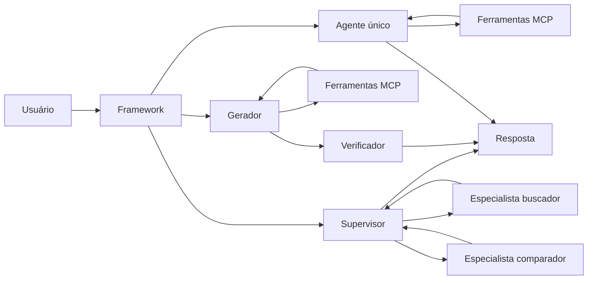
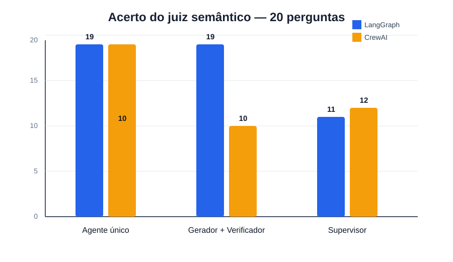
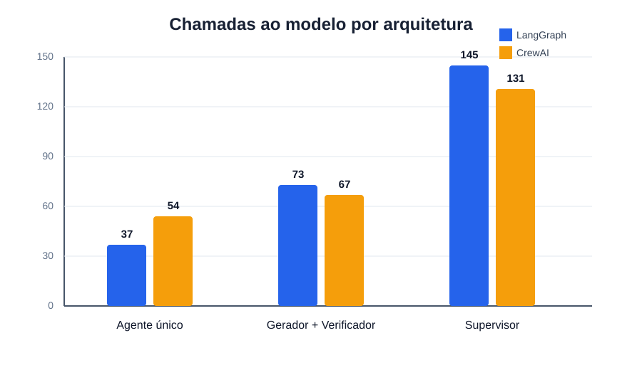

# Análise de Boletins de Urna (BUWeb) — agentes LangGraph e CrewAI (Eleições RN)

Projeto acadêmico de análise e auditoria de **Boletins de Urna (BUWeb)** do
Tribunal Superior Eleitoral (TSE), com dados do Rio Grande do Norte. O notebook
compara três arquiteturas de agentes:

- **Agente único**: linha de base com um modelo e acesso às ferramentas MCP;
- **Gerador + Verificador**: adiciona uma etapa de validação factual;
- **Supervisor + Especialistas**: divide o trabalho entre busca, comparação e redação.

As arquiteturas foram reproduzidas em **LangGraph** e **CrewAI** e avaliadas no
Google Colab com o modelo local `qwen3:8b`, executado pelo Ollama.

**DCA0305 · Machine Learning-Based Systems Design · UFRN**
Baseado na *Lesson 12 — AI Agents III · Multi-agent*.

---

## 🏛️ O que o projeto faz

O agente consulta o arquivo de BU para responder perguntas sobre:

- **Votos por cargo e tipo**: Governador ou Presidente; votos nominais, brancos
  ou nulos;
- **Seções eleitorais**: busca e ranking por filtros, com detalhes de zona,
  seção e município;
- **Comparação de seções**: aptos, comparecimento, abstenções e votos;
- **Eleitorado sem biometria válida**, no total, por zona ou município;
- **Verificação factual**: na arquitetura Gerador–Verificador, afirmações
  numéricas são conferidas com os resultados das ferramentas.

Os totais e comparações são calculados pelas ferramentas sobre os dados, não
estimados pelo modelo. O modelo não tem uma ferramenta de acesso à internet.

---

## 🧠 Arquiteturas avaliadas

| Arquitetura | LangGraph | CrewAI | Propósito |
|---|---|---|---|
| **Agente único** | Modelo e ferramentas MCP em um grafo ReAct | Um agente com ferramentas MCP | Linha de base de execução e redação. |
| **Gerador + Verificador** | Gerador + verificador com validação programática | Agente assistente + agente verificador | Confere fatos contra os resultados das ferramentas. |
| **Supervisor + Especialistas** | Supervisor, buscador, comparador e redator | Gerente hierárquico e agentes especialistas | Divide a tarefa em pesquisa, comparação e resposta final. |



O Gerador–Verificador e o Supervisor–Especialistas adicionam etapas de controle,
mas também podem aumentar latência e chamadas ao modelo.

### Fluxo MCP

```text
┌──────────────────────────────┐       stdio / JSON-RPC       ┌───────────────────────┐
│ LangGraph + Ollama          │ ◄──────────────────────────► │ Servidor FastMCP      │
│ agente único /              │                               │ ferramentas eleitorais│
│ gerador + verificador       │                               └───────────┬───────────┘
└──────────────────────────────┘                                           │
                                                                           ▼
                                                              ┌────────────────────────┐
                                                              │ pandas + CSV BUWeb TSE │
                                                              └────────────────────────┘
```

O cliente LangGraph usa a versão MCP 1.x e o servidor FastMCP usa MCP 2.x.
Por isso, as dependências do servidor são instaladas separadamente em
`servidor_libs/`.

### Ferramentas disponíveis

| Ferramenta | O que consulta |
|---|---|
| `search_secoes` | Busca e ordena seções por tipo de voto, zona, cargo e mínimo de votos. |
| `secao_details` | Detalha aptos, comparecimento, abstenções, biometria e votos de uma seção. |
| `compare_secoes` | Compara duas seções, opcionalmente filtrando por tipo de voto. |
| `total_por_tipo` | Soma votos nominais, brancos ou nulos, com filtro opcional por cargo. |
| `total_sem_biometria` | Soma eleitores sem biometria válida, com filtro opcional por zona ou município. |

O servidor também publica o recurso `eleicao-RN://schema` com as colunas do
arquivo e o prompt `recomendar_analise`.

---

## 📁 Estrutura do projeto

```text
pj_eleicao_multiagente/
├── data/
│   └── bweb_2t_RN_261020260742.csv    # Dados BUWeb do TSE usados pelo projeto
├── notebooks/
│   └── Projeto_AI_Agents_III_Agentes_eleicao.ipynb
├── src/eleicao_ma/
│   ├── arq_a_gerador_verificador.py   # Agente único e arquitetura Gerador–Verificador
│   ├── arq_b_supervisor.py            # Supervisor, especialistas e redator
│   ├── config.py                      # Modelo, caminhos e configuração do MCP
│   ├── data.py                        # Leitura e normalização do CSV
│   ├── mcp_server.py                  # Servidor FastMCP
│   ├── prompts.py                     # Instruções dos agentes
│   ├── tools.py                       # Ferramentas de consulta eleitoral
│   └── utils.py                       # Execução, métricas e exibição
├── tests/
│   ├── test_agent_call_metrics.py     # Métricas e isolamento entre execuções
│   └── test_arqs.py                   # Testes das ferramentas e arquiteturas
├── requirement.txt                    # Dependências do cliente LangGraph
├── requirements-servidor.txt          # Dependências isoladas do FastMCP
└── README.md
```

### Arquivos principais

- <a href="https://github.com/arleswasb/Projeto_AI_Agents_III_Multiagent_eleicao/blob/main/notebooks/Projeto_AI_Agents_III_Agentes_eleicao.ipynb"></a>
  <a href="https://colab.research.google.com/github/arleswasb/Projeto_AI_Agents_III_Multiagent_eleicao/blob/main/notebooks/Projeto_AI_Agents_III_Agentes_eleicao.ipynb"></a>
  [**`notebooks/Projeto_AI_Agents_III_Agentes_eleicao.ipynb`**](./notebooks/Projeto_AI_Agents_III_Agentes_eleicao.ipynb):
  notebook de preparação, experimentos, comparação das arquiteturas e avaliação.
- [**`data/bweb_2t_RN_261020260742.csv`**](./data/bweb_2t_RN_261020260742.csv):
  arquivo BUWeb usado pelas ferramentas e pelos testes.
- [`src/eleicao_ma/`](./src/eleicao_ma/): implementação Python das ferramentas,
  do servidor MCP e das arquiteturas.

---

## ⚙️ Instalação

### Requisitos

- Python 3.10 ou superior;
- [Ollama](https://ollama.com/) instalado e em execução para executar o modelo;
- o CSV em `data/` (já incluído no repositório) ou um caminho definido por
  `BU_DATA_PATH`.

Clone o repositório e crie um ambiente virtual:

```bash
git clone https://github.com/arleswasb/Projeto_AI_Agents_III_Multiagent_eleicao.git
cd Projeto_AI_Agents_III_Multiagent_eleicao

python -m venv .venv
source .venv/bin/activate  # Windows: .venv\Scripts\activate
python -m pip install -r requirement.txt
```

Instale as dependências do servidor MCP isoladamente; não as misture com as do
cliente LangGraph:

```bash
python -m pip install --target servidor_libs -r requirements-servidor.txt
```

O notebook também prepara essas dependências quando executado, se necessário.
Para executar o experimento validado no Colab, o notebook configura o modelo
`qwen3:8b`. Inicie o Ollama e baixe esse modelo:

```bash
ollama serve
```

Em outro terminal:

```bash
ollama pull qwen3:8b
```

---

## 📓 Executar o notebook

- **Google Colab:** use o botão **Open in Colab** acima.
- **Localmente:** abra
  [`notebooks/Projeto_AI_Agents_III_Agentes_eleicao.ipynb`](./notebooks/Projeto_AI_Agents_III_Agentes_eleicao.ipynb)
  no VS Code ou Jupyter e execute as células em ordem, com o ambiente preparado
  e o Ollama ativo.

O notebook organiza o experimento em etapas:

1. prepara e valida os dados BUWeb;
2. configura o servidor MCP, o modelo e as ferramentas;
3. executa as três arquiteturas em LangGraph;
4. repete o benchmark em CrewAI;
5. compara as respostas com um gabarito calculado sobre o CSV e com um juiz LLM;
6. consolida acertos, chamadas ao modelo e tempo de execução.

---

## 📊 Resultados comparativos no Colab

O benchmark utilizou **20 perguntas**, com avaliação em duas dimensões:

- **Checagem automática:** presença dos valores obrigatórios e ausência de afirmações proibidas;
- **Juiz LLM:** correção semântica da resposta em relação ao gabarito oficial calculado com pandas.

### Resultados por framework e arquitetura

| Framework | Arquitetura | Checagem automática | Juiz LLM | Chamadas ao modelo | Tempo |
|---|---|---:|---:|---:|---:|
| LangGraph | Agente único | 16/20 | 19/20 | 37 | 128 s |
| LangGraph | Gerador + Verificador | 17/20 | 19/20 | 73 | 657 s |
| LangGraph | Supervisor + Especialistas | 9/20 | 11/20 | 145 | 356 s |
| CrewAI | Agente único | 10/20 | 10/20 | 54 | 239 s |
| CrewAI | Gerador + Verificador | 8/20 | 10/20 | 67 | 305 s |
| CrewAI | Supervisor + Especialistas | 11/20 | 12/20 | 131 | 572 s |

### Taxa de acerto do juiz semântico



- No **LangGraph**, o Agente Único e o Gerador–Verificador alcançaram **19/20**.
- No **CrewAI**, o melhor resultado foi o **Supervisor + Especialistas**, com **12/20**.
- O Supervisor LangGraph obteve **11/20**, evidenciando que a orquestração hierárquica
  não foi automaticamente superior às arquiteturas mais simples nesta execução.

### Custo operacional



- O **Agente Único LangGraph** teve o menor custo: **37 chamadas** e **128 s**.
- O **Gerador–Verificador LangGraph** consumiu **73 chamadas** e **657 s**.
- O **Supervisor LangGraph** consumiu **145 chamadas** e **356 s**.
- Entre as três versões CrewAI, o Agente Único teve **54 chamadas**, o
  Gerador–Verificador teve **67** e o Supervisor teve **131**.

Os tempos do CrewAI variaram conforme loops internos de delegação e falhas na
estruturação das respostas pelo Ollama. Foram observadas respostas vazias do
modelo `qwen3:8b` e mensagens internas de erro durante o experimento.

### Conclusão comparativa

**LangGraph** apresentou o melhor desempenho nesta execução:

- maior taxa semântica com as arquiteturas Agente Único e Gerador–Verificador;
- menor custo absoluto no Agente Único;
- caminhos de execução mais previsíveis por meio de grafos explícitos;
- controle programático mais rígido no Gerador–Verificador.

**CrewAI** apresentou maior independência entre os agentes, mas ficou abaixo no
benchmark do LangGraph:

- o Agente Único ficou em **10/20** pelo juiz semântico;
- o Gerador–Verificador ficou em **10/20**;
- o Supervisor obteve a melhor taxa CrewAI, com **12/20**;
- houve maior verbosidade, delegação interna e sensibilidade a respostas vazias
  do modelo local.

Esses números representam uma execução observada no conjunto específico de
20 perguntas. Eles não devem ser interpretados como garantia de desempenho para
outras bases, modelos ou ambientes.

---

## 🧪 Testes

Com as dependências instaladas e o arquivo de dados disponível:

```bash
python -m pytest -q
```

Os testes de métricas usam modelos falsos, sem necessidade de iniciar o Ollama.
A avaliação do notebook e os benchmarks com o modelo real requerem o Ollama e o
CSV BUWeb.

---

## 🛡️ Fonte dos dados

O arquivo do projeto é baseado nos Boletins de Urna disponibilizados pelo TSE.
Consulte o [Portal de Dados Abertos do TSE](https://dadosabertos.tse.jus.br/)
para informações sobre os dados eleitorais e suas atualizações.
